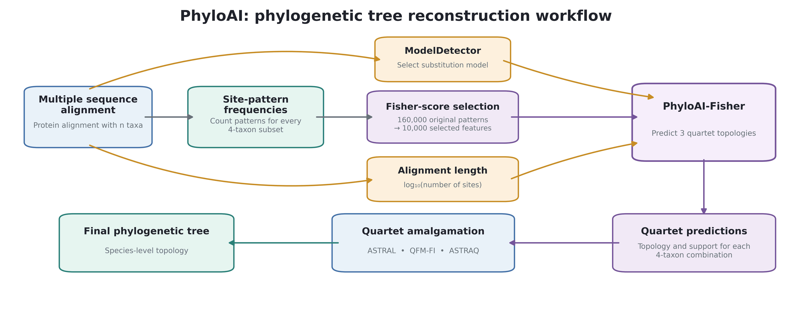
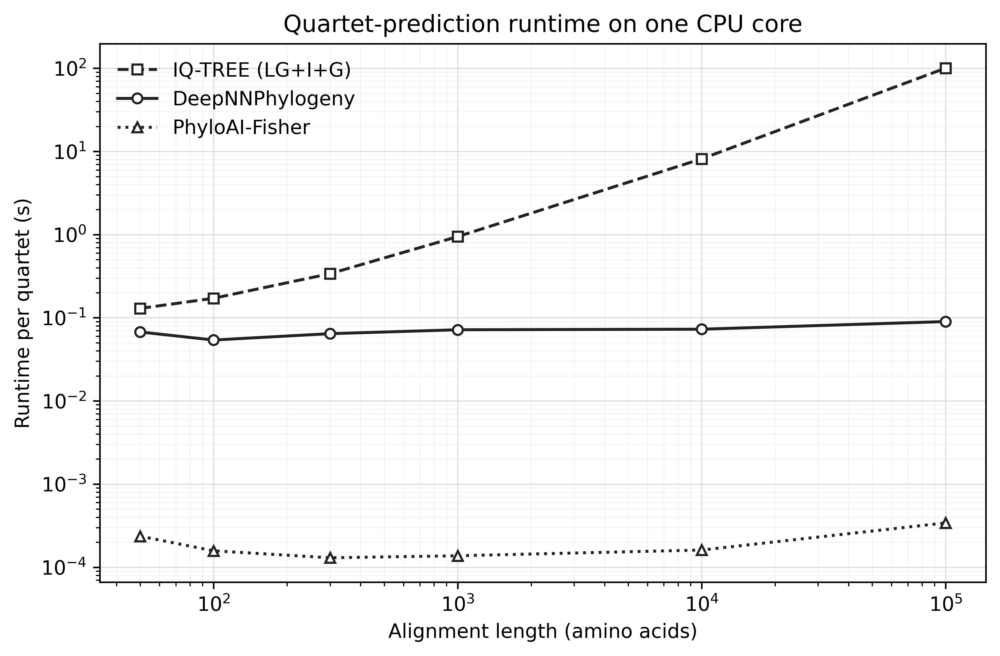

<p align="center">
  
</p>

PhyloAI (improved version of DeepNNPhylogeny) reconstructs phylogenetic trees from protein alignments using neural
networks. The pipeline combines ModelDetector substitution-model selection,
model-specific quartet prediction with PhyloAI, and quartet amalgamation with ASTRAL,
QFM-FI, or ASTRAQ.

## How does PhyloAI work?



PhyloAI-Fisher uses 10,000 Fisher-selected site-pattern frequencies and alignment
length to predict quartet topologies. These quartets are combined into a larger
tree. Site patterns and effective quartet lengths are extracted with Quartet Pattern Counter (QPC);
This workflow also supports the usage of six-state recoded models.

## Why use PhyloAI?



PhyloAI is around 263-522 times faster than [DeepNNPhylogeny](https://github.com/cmayer/DeepNNPhylogeny) for the individual quartets predictions. 
IQ-TREE runtime increases strongly with alignment lengths. For the 100,000 long alignments, PhyloAI was approximately 294,000 times faster than IQ-TREE.


## Installation

Use Miniforge (recommended) or another conda installation, with Git available.
Installation uses only `conda-forge` and `bioconda`; Anaconda's `defaults`
channels are explicitly excluded. This does not change individual software
or model licenses.

```bash
git clone --branch phyloai-protein --single-branch https://github.com/KulyaNikita/PhyloAI.git
cd PhyloAI
bash install.sh
conda activate phyloAI
```

The installer prepares the environment, installs QPC, ModelDetector, ASTRAL,
QFM-FI and ASTRAQ, and builds PolyMoSim. It also downloads 15 Fisher and three six-state-LA pretrained
[PhyloAI protein models on Kaggle](https://www.kaggle.com/models/nikitakulya/phyloai-protein)
into `PhyloAI-Fisher-Kaggle/`.

For a manually managed environment:

```bash
conda env create -f environment.yml
conda activate phyloAI
bash install.sh --existing-env
```

For an existing environment, use `conda env update -f environment.yml` instead
of `conda env create`. Add `--skip-polymosim` to the installer if simulation
is not needed. To download or verify the models separately, run
`python download_protein_models.py`.

## Run the workflow

Provide an aligned protein FASTA file containing at least four sequences.
Use `--format` for another supported alignment format.

### Quick start

After installation and activating `phyloAI`, run:

```bash
python run_phyloai.py --alignment proteins.fasta --output results
```

This uses ModelDetector, the installed Fisher models, unweighted ASTRAQ, and
one CPU thread. Replace `proteins.fasta` with your alignment; `results` must
be a new output directory. The final tree is saved as `results/astraq.tre`.

### Concatenated alignment

```bash
python run_phyloai.py \
  --alignment proteins.fasta \
  --method astraq --threads 1 \
  --output results_concatenated
```

### Per-gene alignments

```bash
python run_phyloai.py \
  --alignment genes/ \
  --method all --threads 1 \
  --output results_per_gene
```

ModelDetector selects a model for  each alignment independently; predicted quartets are pooled to reconstruct
one final tree per amalgamation method. Taxon identifiers must be consistent across genes.

| `--method` | Amalgamation |
|---|---|
| `astraq` | ASTRAQ, unweighted (default) |
| `astraqw` | ASTRAQw, confidence-weighted |
| `astral` | ASTRAL |
| `qfm` | QFM-FI |
| `all` | All four methods |

To skip ModelDetector and specify a substitution model:

```bash
python run_phyloai.py \
  --alignment proteins.fasta --substitution-model LG \
  --method astraqw --threads 1 --output results_LG
```

ModelDetector supports 13 matrices; DCMut and JTTDCMut require explicit
`--substitution-model` selection. The default family is `fisher`.
The runner also supports `--family 6-state-la` and `--family deepnnphylogeny`;
the three 6-state-LA networks are installed automatically in the same model
directory. Original [DeepNNPhylogeny networks](https://zenodo.org/records/7772948) must be provided separately
with `--models /path/to/models`.
Each network must retain its matching metadata and, for Fisher, its selector. Available
6-state-LA models cover Dayhoff, JTT (SR-6), and WAG (KGB-6).

Outputs include final trees (`astraq.tre`, `astraqw.tre`, `astral.tre`, and/or
`qfm.tre`), quartet predictions, logs, `run_summary.json`, and
`running_times.tsv`. Existing output directories are not overwritten.

```bash
python run_phyloai.py --help
```

## Train models

Generate all entries in a training scheme with `simulate_training_data.py`:

```bash
python simulate_training_data.py \
  -substitution_model LG --training-scheme training_scheme.txt \
  -processes 4 -output_dir simulation_output
```

Alternatively, simulate fixed-length data without a scheme:

```bash
python simulate_training_data.py \
  -substitution_model LG --alignment-length 1000000 --replicates 50000 \
  -processes 4 -output_dir simulation_output_fixed
```

Counts apply per topology and branch regime (three topologies × two regimes).
The supplied scheme generates 1,068,000 examples; the fixed-length example
generates 300,000.  Results are written to disk in bounded
batches (`--batch-size`, default 1,000), producing frequency, label and raw-length
NumPy files. 
See the [simulation details](additional_scripts/README.md#training-data).

Use `train_phyloai.py` with matching NumPy frequency and topology-label arrays.
The simulator saves 160,000 frequency columns in `ACDEFGHIKLMNPQRSTVWY`
Cartesian-product order; raw lengths are stored in a separate file.
Fisher and six-state-LA require this separate file through `--length-data`.
Labels are 0 = AB|CD, 1 = AC|BD, and 2 = AD|BC. Multiple matching files may be
supplied in the same order. Frequency arrays are memory-mapped and read in
batches rather than loaded entirely into RAM.

```bash
python train_phyloai.py \
  --training-data simulation_output/site_pattern_frequencies_LG_scheme_training_scheme.npy \
  --topology-data simulation_output/trainTopoClass_LG_scheme_training_scheme.npy \
  --length-data simulation_output/trainLength_LG_scheme_training_scheme.npy \
  --substitution-model LG --method fisher \
  --selected-patterns 10000 --architecture b1 \
  --length-transform log10 \
  --output-dir trained/LG --threads 8
```

This trains a Fisher model with separate pattern and length inputs. The trainer
supports three families: `--method raw` for fixed-length full-pattern
DeepNNPhylogeny-like networks, `--method fisher` for Fisher, and
`--method six-state --recoding dayhoff-6` (or `sr-6`, `kgb-6`) for six-state-LA.
B1 and B3 architectures (for more details see [DeepNNPhylogeny](https://doi.org/10.1016/j.ympev.2024.108181)) are available The length-aware families require
length files; fixed-length raw models do not accept a length input.
It saves the network, metadata, training history, and transformed `.features.npy`
arrays for Fisher and six-state runs. These arrays can be reused with
`--input-format selected --selector-model SELECTOR.npz` or
`--input-format recoded`, respectively; lengths and topology labels remain separate.

See [additional scripts and detailed training documentation](additional_scripts/README.md)
for simulation details, training-data preparation, and simulated-data benchmarking.

```bash
python train_phyloai.py --help
```

## Credits and citation

PhyloAI builds on [DeepNNPhylogeny (Kulikov et al., 2024)](https://doi.org/10.1016/j.ympev.2024.108181).
Please also cite the tools used in your analysis:

- [ModelDetector](https://academic.oup.com/jeb/article/38/1/129/7901717):
  pretrained weights from [Tinh Nguyen's Figshare deposit](https://doi.org/10.6084/m9.figshare.24711765.v22), licensed CC BY 4.0.
- [ASTRAL](https://doi.org/10.1186/s12859-018-2129-y).
- [QFM-FI (Mim et al., 2023)](https://doi.org/10.1093/bioinformatics/btad332).

