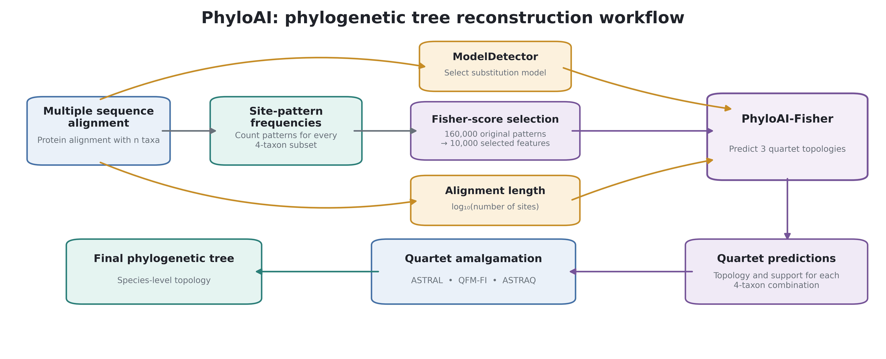
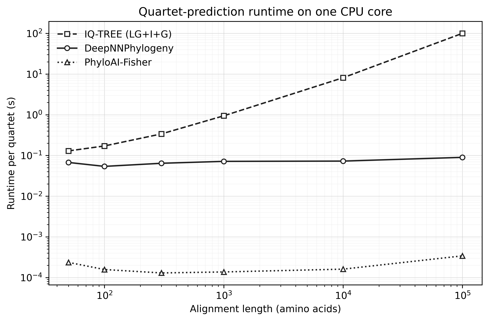

<p align="center">
  
</p>

PhyloAI (improved version of DeepNNPhylogeny) reconstructs phylogenetic trees from protein alignments using neural
networks. The pipeline combines ModelDetector substitution-model selection,
model-specific quartet prediction with PhyloAI, and quartet amalgamation with ASTRAL,
QFM-FI, or ASTRAQ.

## How does PhyloAI work?



PhyloAI-Fisher uses 10,000 Fisher-selected site-pattern frequencies and alignment
length to predict quartet topologies. These quartets are combined into a larger
tree. Site patterns and effective quartet lengths are extracted with Quartet Pattern Counter (QPC);
This workflow also supports the usage of six-state recoded models.

## Why use PhyloAI?



PhyloAI is around 263-522 times faster than [DeepNNPhylogeny](https://github.com/cmayer/DeepNNPhylogeny) for the individual quartets predictions. 
IQ-TREE runtime increases strongly with alignment lengths. For the 100,000 long alignments, PhyloAI was approximately 294,000 times faster than IQ-TREE.


## Installation

### With conda (recommended)

PhyloAI and all the programs it uses are on [bioconda](https://bioconda.github.io/).
Use [Miniforge](https://github.com/conda-forge/miniforge) or another conda installation:

```bash
conda create -n phyloai -c conda-forge -c bioconda phyloai
conda activate phyloai
phyloai download-models
phyloai check
```

This installs PhyloAI with [Quartet Pattern Counter (QPC)](https://github.com/cmayer/QuartetPatternCounter),
[ASTRAQ](https://github.com/KulyaNikita/ASTRAQ), [ASTRAL](https://github.com/smirarab/ASTRAL),
[QFM-FI](https://github.com/sharmin-mim/qfm_java), [PolyMoSim](https://github.com/cmayer/PolyMoSim),
Java and TensorFlow. `phyloai check` reports what is installed.

### Models

The pretrained networks are not part of the package. `phyloai download-models` downloads the 15 Fisher
and three six-state-LA
[PhyloAI protein models from Kaggle](https://www.kaggle.com/models/nikitakulya/phyloai-protein)
(about 525 MB) and ModelDetector from Figshare, and checks every file against its SHA-256 checksum.
They go into the PhyloAI data folder:

- `~/.local/share/phyloai` on Linux (or `$XDG_DATA_HOME/phyloai`)
- `~/Library/Application Support/phyloai` on macOS
- the folder in the `PHYLOAI_DATA` environment variable, if it is set

The networks are in `models/` and ModelDetector in `ModelDetector.h5`. All conda environments share
the data folder, so the models are downloaded only once. Use `--family fisher` or `--family 6-state-la`
to download only one family, and `phyloai run --models DIR --detector FILE` for models elsewhere.

### From the source code (development)

```bash
git clone https://github.com/KulyaNikita/PhyloAI.git
cd PhyloAI
bash install.sh
conda activate phyloAI
```

`install.sh` creates the conda environment `phyloAI` from `environment.yml` (the programs come from
bioconda), installs PhyloAI into it with `pip install -e .` and downloads the models. Use
`--no-models` to skip the download, and `--existing-env` to install into the active environment.
Run the tests with `pytest`.

PhyloAI also installs with pip (`pip install .`), but QPC and the external programs are only available from conda.

### Upgrading from PhyloAI 1.x

The scripts `run_phyloai.py`, `simulate_training_data.py`, `train_phyloai.py`,
`download_protein_models.py` and `recode_aa_frequencies_6state.py`
still work and call the new `phyloai` commands. They will be removed in a later release.
`run_phyloai.py` still uses `PhyloAI-Fisher-Kaggle/` and `ModelDetector.h5` in the source folder if
they are there. To use those models with `phyloai run`, move them into the data folder:

```bash
mkdir -p ~/.local/share/phyloai
mv PhyloAI-Fisher-Kaggle ~/.local/share/phyloai/models
mv ModelDetector.h5 ~/.local/share/phyloai/
phyloai check
```

## Commands

| Command | Purpose |
|---|---|
| `phyloai run` | Reconstruct a species tree from protein alignments |
| `phyloai download-models` | Download and verify the networks and ModelDetector |
| `phyloai check` | Check the installation: packages, programs and models |
| `phyloai simulate` | Simulate training data with PolyMoSim using a built-in model or `--custom-model FILE` |
| `phyloai train` | Train Fisher, six-state-LA or full-pattern networks |
| `phyloai recode-6state` | Collapse 20-state frequencies into a six-state recoding |
| `phyloai test-datasets` | Simulate test alignments and evaluate networks (and IQ-TREE) |

`phyloai <command> --help` shows the options of each command.

## Run the workflow

Provide an aligned protein FASTA file containing at least four sequences.
Use `--format` for another supported alignment format.

### Quick start

After installation and `phyloai download-models`, run:

```bash
phyloai run --alignment proteins.fasta --output results
```

This uses ModelDetector, the installed Fisher models, unweighted ASTRAQ, and
one CPU thread. Replace `proteins.fasta` with your alignment; `results` must
be a new output directory. The final tree is saved as `results/astraq.tre`.

### Concatenated alignment

```bash
phyloai run \
  --alignment proteins.fasta \
  --method astraq --threads 1 \
  --output results_concatenated
```

### Per-gene alignments

```bash
phyloai run \
  --alignment genes/ \
  --method all --threads 1 \
  --output results_per_gene
```

ModelDetector selects a model for  each alignment independently; predicted quartets are pooled to reconstruct
one final tree per amalgamation method. Taxon identifiers must be consistent across genes.

| `--method` | Amalgamation |
|---|---|
| `astraq` | ASTRAQ, unweighted (default) |
| `astraqw` | ASTRAQw, confidence-weighted |
| `astral` | ASTRAL |
| `qfm` | QFM-FI |
| `all` | All four methods |

To skip ModelDetector and specify a substitution model:

```bash
phyloai run \
  --alignment proteins.fasta --substitution-model LG \
  --method astraqw --threads 1 --output results_LG
```

ModelDetector supports 13 matrices; DCMut and JTTDCMut require explicit
`--substitution-model` selection. The default family is `fisher`.
The runner also supports `--family 6-state-la` and `--family deepnnphylogeny`;
the three 6-state-LA networks are downloaded by `phyloai download-models` into the same model
folder. Original [DeepNNPhylogeny networks](https://zenodo.org/records/7772948) must be provided separately
with `--models /path/to/models`.
Each network must retain its matching metadata and, for Fisher, its selector. Available
6-state-LA models cover Dayhoff, JTT (SR-6), and WAG (KGB-6).

Outputs include final trees (`astraq.tre`, `astraqw.tre`, `astral.tre`, and/or
`qfm.tre`), quartet predictions, logs, `run_summary.json`, and
`running_times.tsv`. Existing output directories are not overwritten.

```bash
phyloai run --help
```

## Train models

Generate all entries in a training scheme with `phyloai simulate`:

```bash
phyloai simulate \
  -substitution_model LG --training-scheme training_scheme.txt \
  -processes 4 -output_dir simulation_output
```

Alternatively, simulate fixed-length data without a scheme:

```bash
phyloai simulate \
  -substitution_model LG --alignment-length 1000000 --replicates 50000 \
  -processes 4 -output_dir simulation_output_fixed
```

Counts apply per topology and branch regime (three topologies × two regimes).
The supplied scheme generates 1,068,000 examples; the fixed-length example
generates 300,000.  Results are written to disk in bounded
batches (`--batch-size`, default 1,000), producing frequency, label and raw-length
NumPy files. 
See the [simulation details](docs/training-and-benchmarking.md#training-data).

Use `phyloai train` with matching NumPy frequency and topology-label arrays.
The simulator saves 160,000 frequency columns in `ACDEFGHIKLMNPQRSTVWY`
Cartesian-product order; raw lengths are stored in a separate file.
Fisher and six-state-LA require this separate file through `--length-data`.
Labels are 0 = AB|CD, 1 = AC|BD, and 2 = AD|BC. Multiple matching files may be
supplied in the same order. Frequency arrays are memory-mapped and read in
batches rather than loaded entirely into RAM.

```bash
phyloai train \
  --training-data simulation_output/site_pattern_frequencies_LG_scheme_training_scheme.npy \
  --topology-data simulation_output/trainTopoClass_LG_scheme_training_scheme.npy \
  --length-data simulation_output/trainLength_LG_scheme_training_scheme.npy \
  --substitution-model LG --method fisher \
  --selected-patterns 10000 --architecture b1 \
  --length-transform log10 \
  --output-dir trained/LG --threads 8
```

This trains a Fisher model with separate pattern and length inputs.
Training uses Keras 2: built into TensorFlow 2.15, and the package `tf-keras` (installed with
PhyloAI) for newer TensorFlow versions; `phyloai train` selects it automatically. The trainer
supports three families: `--method raw` for fixed-length full-pattern
DeepNNPhylogeny-like networks, `--method fisher` for Fisher, and
`--method six-state --recoding dayhoff-6` (or `sr-6`, `kgb-6`) for six-state-LA.
B1 and B3 architectures (for more details see [DeepNNPhylogeny](https://doi.org/10.1016/j.ympev.2024.108181)) are available The length-aware families require
length files; fixed-length raw models do not accept a length input.
It saves the network, metadata, training history, and transformed `.features.npy`
arrays for Fisher and six-state runs. These arrays can be reused with
`--input-format selected --selector-model SELECTOR.npz` or
`--input-format recoded`, respectively; lengths and topology labels remain separate.

See the [training and benchmarking guide](docs/training-and-benchmarking.md)
for simulation details, training-data preparation, and simulated-data benchmarking.

```bash
phyloai train --help
```

## Credits and citation

PhyloAI builds on [DeepNNPhylogeny (Kulikov et al., 2024)](https://doi.org/10.1016/j.ympev.2024.108181).
Please also cite the tools used in your analysis:

- [ModelDetector](https://academic.oup.com/jeb/article/38/1/129/7901717):
  pretrained weights from [Tinh Nguyen's Figshare deposit](https://doi.org/10.6084/m9.figshare.24711765.v22), licensed CC BY 4.0.
- [ASTRAL](https://doi.org/10.1186/s12859-018-2129-y).
- [QFM-FI (Mim et al., 2023)](https://doi.org/10.1093/bioinformatics/btad332).

## Acknowledgements

Dr. Anestis Gkanogiannis restructured PhyloAI 1.1.0 as a Python package with the `phyloai` command,
moved ASTRAQ, QPC, PolyMoSim and QFM-FI into their own bioconda packages, and set up the conda
installation, the model downloads, the tests and GitHub Actions.
